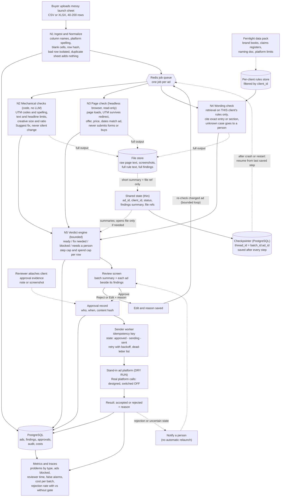
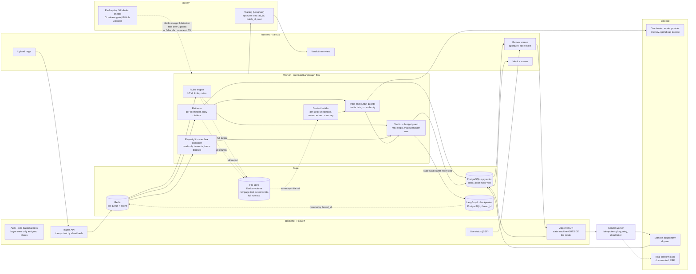
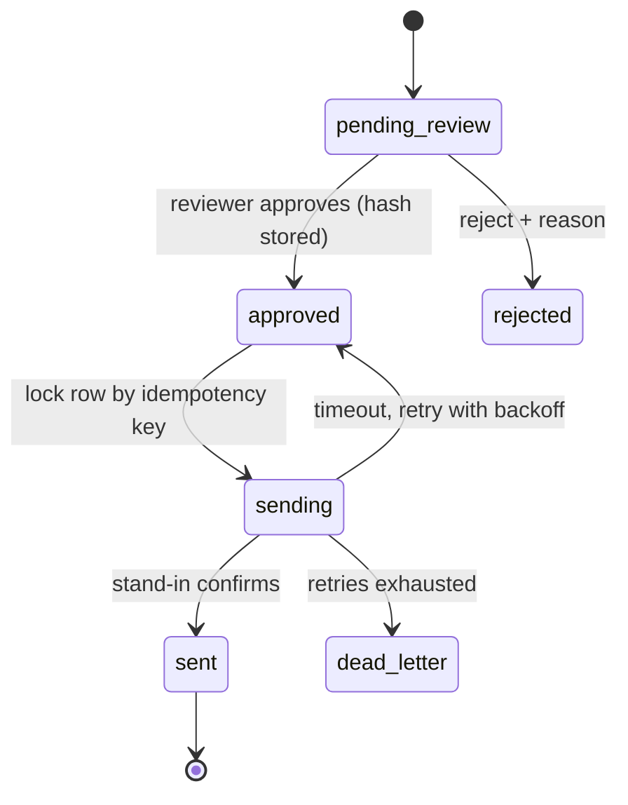
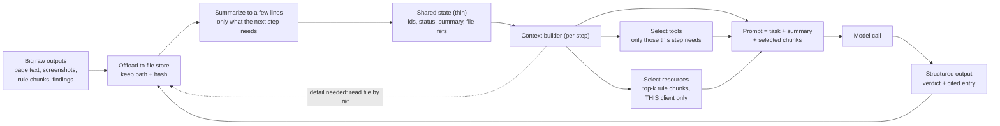
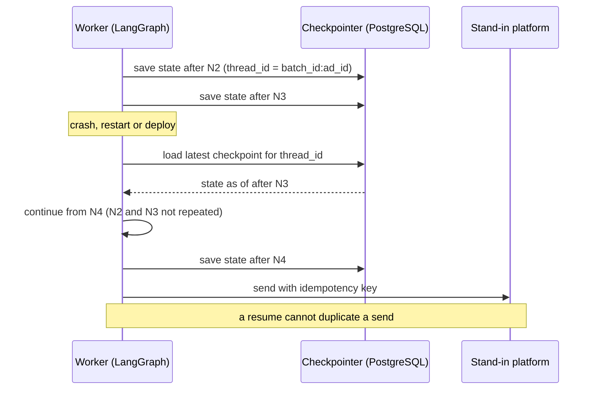

# Launch Gate: Dataflow and Architecture (v2)

Companion to `Launch_Gate_Mini_PRD.md` (v2). **If the two ever disagree: the PRD wins on scope, this file wins on structure.**

**Source tags used in both files**
- **[B]** = Fernlight brief
- **[N]** = your handwritten notes
- **[D#]** = a decision recorded in the PRD, section 9 (decision log)

Every box below carries one of these tags in the mapping table at the end. Nothing is in a diagram unless it has a tag.

---

## 1. Dataflow diagram

Solid arrow = main flow. Dotted arrow = supporting flow. Nothing goes live without a person's approval. [B R6]

---

## 2. Architecture diagram

---

## 3. Send exactly once: state machine

A second click on Approve, or a retry after a crash, finds the row already `sending` or `sent` and does nothing. The checkpointer resumes checks; only the idempotency key protects sending.

---

## 4. Context engineering: shared state, files, summaries

Big data goes to a file; state keeps a short summary and a reference. Each step gets only what it needs.

---

## 5. Checkpointer: resume after a stop

---

## 6. Mapping: every box to its source

| Box | PRD section | Source |
|---|---|---|
| N1 Ingest, dedup, bad-row isolation, Redis queue | 4.1 | [B R1], [N] Redis |
| CSV and XLSX upload | 4.1 | [D5], [N] "excel sheet" |
| N2 Mechanical checks | 4.2 | [B R2] |
| N3 Page check, Playwright, read-only | 4.3 | [B R3] |
| N4 Wording check, per-client retrieval, citations | 4.4 | [B R4], [N] RAG |
| pgvector in PostgreSQL | 7 | [D6] |
| N5 Verdict engine, step and spend caps | 4.5 | [B R5] |
| Review screen, edits and reasons | 4.6 | [B R6] |
| Approval record with content hash | 4.6 | [D13], [B R6] |
| Client approval evidence (note or screenshot) | 4.6 | [D3], [B section 4 Tobias] |
| Sender, idempotency key, dead-letter | 4.6 | [B R6] |
| Stand-in platform; real calls OFF | 4.6 | [B R6] |
| Auth and role-based access | 4.8 | [B R8] |
| Guards: text is data | 4.8 | [B R8], [N] guardrails |
| Metrics screen | 4.7 | [B R7] |
| Tracing (Langfuse) | 4.9 | [B R9], [D8] |
| Eval replay and CI gate (GitHub Actions) | 4.7 | [B R7], [D9] |
| File store (Docker volume) | 5 | [N] context engineering, [D7] |
| Shared state, context builder | 5 | [N] context engineering |
| Checkpointer, `thread_id` | 5 | [N] checkpointer, [D18] |
| Live status (SSE) | 7 | [D12] |
| Next.js, FastAPI, Redis, PostgreSQL | 7 | [N], [B section 8] |
| One hosted model provider, spend cap in code | 7 | [B R5, section 8], [D11] |

**Removed from v1 diagrams** (compared with v1 of this file): client approval link, MCP publishing, auto-correct and relaunch, post-launch monitoring nodes 10 to 12. They are listed under "NOT in scope" in the PRD.
