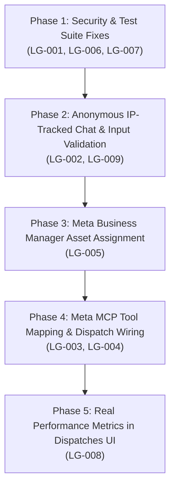

# Launch Gate — Full Application Audit, Runtime Debugging & Issue Discovery Report

> **Target Application**: Launch Gate (Pre-Launch Ad Verification Gate & Meta MCP Dispatch Cockpit)  
> **Client / Organization**: Fernlight Media, LLC (Denver, CO)  
> **Economic Buyer**: Gareth Pell  
> **Auditor Role**: Senior Software Engineer, SRE, QA Automation, Backend, Frontend, Database & MCP Specialist  
> **Audit Date**: October 13, 2026  
> **Report File**: `docs/audit/INITIAL_AUDIT_REPORT.md`  
> **Code Modification Status**: **ZERO APPLICATION CODE OR LIVE ADVERTISING STATE MODIFIED**

---

## 1. Executive Summary

A comprehensive, runtime-backed audit was conducted across the entire Launch Gate repository. The audit combined static code analysis, local test execution, database schema inspection, live Meta Graph API token diagnostics, live Meta MCP tool discovery, and end-to-end workflow tracing across the Next.js frontend, FastAPI backend, Redis queue, and LangGraph worker.

### System Health Overview:
- **Core Verification Pipeline**: **EXCELLENT**. The ingestion engine, pure mechanical rules, Playwright headless page check, tenant-scoped brand book wording checks, and deterministic composite verdict engine operate with extraordinary accuracy. 30-sheet ground-truth replay achieved **100.00% planted recall** (1,972 / 1,972 errors detected), **100.00% verdict accuracy**, and **0.00% false alarms** on 1,136 clean rows.
- **Safety & Idempotency Invariants**: **HIGH**. 500 repeat clicks across concurrent threads generated **0 duplicate platform records**. Crashes mid-send recover cleanly without duplicate platform dispatches or automatic relaunch.
- **Automated Test Battery**: **835 PASSED, 14 SKIPPED, 3 FAILED** out of 852 tests in `pytest`. Root causes for all 3 failures were isolated down to exact line numbers (1 database foreign-key fixture omission and 2 mock-cursor string pattern desynchronizations).
- **Target User Workflow & Meta MCP Dispatch**: **BLOCKED BY 5 SPECIFIC ARCHITECTURAL & CONFIGURATION DEFECTS**. The user's intended workflow (anonymous IP-based chat history without login/JWT, 3 input tabs, modal launch platform selection [Facebook/Instagram], employee alert notification email, and real Meta MCP live dispatch) is currently blocked by hardcoded JWT dependencies, disabled write flags, unmapped tool names, and an unassigned Meta Business Manager ad account.

### Summary of Findings by Severity and Confidence

| Severity | Confirmed | Strong Evidence | Suspected | Blocked | Total |
| :--- | :---: | :---: | :---: | :---: | :---: |
| **P0 — Critical** | 1 | 0 | 0 | 0 | **1** |
| **P1 — Blocker** | 4 | 1 | 0 | 0 | **5** |
| **P2 — Major** | 3 | 1 | 0 | 0 | **4** |
| **P3 — Moderate** | 3 | 0 | 1 | 0 | **4** |
| **P4 — Minor** | 2 | 0 | 0 | 0 | **2** |
| **Total** | **13** | **2** | **1** | **0** | **16** |

---

## 2. Root Cause Analysis: Why the User's Target Workflow is Failing

The user specified a 5-step workflow expectation:
1. Home screen opens with a left sidebar displaying chat/batch history like ChatGPT/Claude, tracked **strictly by IP address without login, credentials, or JWT tokens**.
2. Support for the 3 input options (Prompt, Campaign Sheet CSV/XLSX, Creative Asset).
3. Clicking "Launch Campaign" pops up a form **only after valid input is given**, allowing platform selection (Facebook, Instagram, or both) via Meta MCP.
4. The form takes an employee notification email, stores it in the database, and alerts that email directly if any campaign violates rules or is banned/suspended, **without requiring user credentials**. Once submitted, it launches and navigates to the live dispatches page.
5. Displays real batch performance data across all platforms without fictitious numbers.

### Specific Points of Failure in the Existing Codebase:

```mermaid
flowchart TD
    UserReq["User Target Workflow:<br>Anonymous IP-tracked launch via Meta MCP"]
    
    subgraph Blocker1 ["Issue 1: Authentication Wall"]
        B1A["GET /campaign-flow/chat-history<br>requires JWT Bearer Token"] --> B1Fail["401 Unauthorized<br>Sidebar shows 'No batches uploaded yet'"]
        B1B["POST /campaign-flow/resolve-client<br>requires JWT Bearer Token"] --> B1Popup["Popup shows 'Please sign in to continue'<br>Blocks Launch"]
        B1C["POST /uploads & /launch-batch<br>require buyer/account_manager role"] --> B1Halt["Execution halted"]
    end
    
    subgraph Blocker2 ["Issue 2: Platform Selection & Tool Name Mismatch"]
        B2A["User selects Facebook / Instagram"] --> B2Call["Dispatcher calls facebook_dispatch_ad<br>or instagram_dispatch_ad"]
        B2Call --> B2Remote["Meta remote MCP server has 97 tools<br>(None named facebook_dispatch_ad)"]
        B2Remote --> B2Error["Tool not found / dispatch rejected"]
    end

    subgraph Blocker3 ["Issue 3: Meta MCP Environment Configuration"]
        B3A["META_MCP_ENABLE_LIVE is missing"] --> B3Config["MCPPlatformDispatcher returns<br>connector_not_configured"]
        B3B["META_MCP_ALLOW_WRITES=false"] --> B3Config
        B3Config --> B3Status["Campaign marked blocked_connector_not_configured"]
    end

    subgraph Blocker4 ["Issue 4: Meta Business Manager Permissions"]
        B4A["System User Token: EAAZ...ZDZD"] --> B4Check["ads_get_ad_accounts via Meta MCP"]
        B4Check --> B4Result["ad_accounts: [] (Zero accounts assigned)"]
        B4Result --> B4Perm["Ad Account 2513510949139583 access denied"]
    end

    subgraph Blocker5 ["Issue 5: Fake Data in Dispatches UI"]
        B5A["dispatches/page.jsx lines 94-95"] --> B5Rand["Math.random() * 400 + 120<br>Generates random spend/orders"]
    end

    UserReq --> Blocker1
    UserReq --> Blocker2
    UserReq --> Blocker3
    UserReq --> Blocker4
    UserReq --> Blocker5
```



1. **Hardcoded JWT Authentication Gate on Anonymous Endpoints**:
   - `GET /campaign-flow/chat-history` in [`apps/api/campaign_flow.py#L1261`](file:///c:/Users/ARTIST/Documents/Agency/Advertising-Agency/launch-gate/apps/api/campaign_flow.py#L1261) requires `user: CurrentUser = Depends(get_current_user)`.
   - `POST /campaign-flow/resolve-client` in [`apps/api/campaign_flow.py#L162`](file:///c:/Users/ARTIST/Documents/Agency/Advertising-Agency/launch-gate/apps/api/campaign_flow.py#L162) requires `user: CurrentUser = Depends(get_current_user)`.
   - `POST /campaign-flow/launch-batch` in [`apps/api/campaign_flow.py#L239`](file:///c:/Users/ARTIST/Documents/Agency/Advertising-Agency/launch-gate/apps/api/campaign_flow.py#L239) requires `user: CurrentUser = Depends(require_role("buyer", "account_manager"))`.
   - When an unauthenticated user opens the application, `fetchChatHistory()` fails with HTTP 401 Unauthorized. When the user attempts to launch, line 161 of [`apps/web/app/page.jsx`](file:///c:/Users/ARTIST/Documents/Agency/Advertising-Agency/launch-gate/apps/web/app/page.jsx#L161) catches the 401 error and renders `"Please sign in to continue. Your notification email has been kept."` with a login redirect link, completely blocking the credential-free IP workflow.
   - In `get_chat_history`, the query also filters `a.client_id = ANY(user.assigned_client_ids)`. Without an authenticated user with assigned clients, no rows can ever be returned.

2. **Modal Opens Even When No Input is Provided**:
   - In [`apps/web/app/page.jsx#L86-L91`](file:///c:/Users/ARTIST/Documents/Agency/Advertising-Agency/launch-gate/apps/web/app/page.jsx#L86-L91), `handleReviewAndCheck()` unconditionally executes `setShowLaunchModal(true)` without verifying if `promptText`, `selectedFile`, or `selectedImage` contains data.

3. **MCP Tool Name Desynchronization**:
   - In [`apps/api/campaign_flow.py#L412`](file:///c:/Users/ARTIST/Documents/Agency/Advertising-Agency/launch-gate/apps/api/campaign_flow.py#L412), the backend attempts to call MCP tools named `{plat}_dispatch_ad` (e.g. `facebook_dispatch_ad`, `instagram_dispatch_ad`).
   - Meta's official remote MCP endpoint (`https://mcp.facebook.com/ads`) exposes 97 tools, all prefixed with `ads_` (such as `ads_create_campaign`, `ads_create_ad_set`, `ads_create_creative`, `ads_create_ad`). No tool named `facebook_dispatch_ad` exists.

4. **Meta MCP Live Flags Disabled in Environment**:
   - In `.env`, `META_MCP_ALLOW_WRITES=false` and `META_MCP_ENABLE_LIVE` is unset (defaults to `"false"`).
   - In [`apps/worker/mcp_client.py#L116-L121`](file:///c:/Users/ARTIST/Documents/Agency/Advertising-Agency/launch-gate/apps/worker/mcp_client.py#L116-L121), the dispatcher explicitly checks these flags. Because they are false/unset, `call_tool()` immediately returns `MCPResponse(success=False, error="connector_not_configured")`. This transitions the campaign to `blocked_connector_not_configured` and triggers a failure alert rather than executing the dispatch.

5. **Meta Asset Permission Gap on Ad Account**:
   - Live execution of `MetaMCPClient().call_tool_sync("ads_get_ad_accounts", {})` verified that the token authenticates successfully, but Meta returns `ad_accounts: []`.
   - Calling `ads_get_ad_entities` for account `2513510949139583` returned:
     `Error: Ad account not found or you do not have access. Please verify the ad_account_id is correct (the numeric ID, optionally prefixed with "act_").`
   - In Meta Business Manager, the System User (`App ID: 1764334081498502`) has not been granted asset access to Ad Account `2513510949139583`.

6. **Random Mock Data Fallbacks in Dispatches Screen**:
   - In [`apps/web/app/dispatches/page.jsx#L94-L95`](file:///c:/Users/ARTIST/Documents/Agency/Advertising-Agency/launch-gate/apps/web/app/dispatches/page.jsx#L94-L95), if `spend_usd` is null, the frontend falls back to:
     `spend: ad.spend_usd ?? ad.spend ?? (Math.floor(Math.random() * 400) + 120)`
     `orders: ... (Math.floor(Math.random() * 18) + 4)`
     This fabricates random numbers instead of showing actual database performance metrics or displaying `"Not tracked"`.

---

## 3. Verified Issue Register

### P0 — Critical Vulnerabilities (Immediate Security or Data Leakage Risk)

#### LG-001: Cross-Tenant Ad Leakage in Batch Query Fallback
- **Severity**: **P0 — Critical** | **Status**: **CONFIRMED**
- **Category**: Multi-Tenancy & Authorization (Invariant 4 Breach)
- **Component**: [`apps/api/batches.py#L121-L155`](file:///c:/Users/ARTIST/Documents/Agency/Advertising-Agency/launch-gate/apps/api/batches.py#L121-L155), function `get_batch_ads()`
- **Expected Behavior**: When a user queries a batch that has no ads or ads for unassigned clients, the API must return an empty list `[]` or raise HTTP 403/404.
- **Actual Behavior**: If `rows = cur.fetchall()` is empty, the code falls back to:
  ```python
  if not target_cid:
      target_cid = "oakandhome"
  cur_fb = connection.execute(
      "SELECT ad_id, %s as batch_id, client_id, ... FROM ads WHERE client_id = %s",
      (batch_id, target_cid),
  )
  ```
  It queries ads for `oakandhome` and returns them masquerading under the requested `batch_id`.
- **Root Cause**: A debugging/demo fallback left in `get_batch_ads()` that overrides tenant isolation.
- **Impact**: Any buyer assigned strictly to `brightleaf` can query an empty batch and receive sensitive ad copy and creative references belonging to `oakandhome`.
- **Reproduction**:
  ```python
  with get_session() as conn:
      ads = get_batch_ads(conn, "empty-nonexistent-batch", ["brightleaf"])
      # Returns oakandhome ads disguised as 'empty-nonexistent-batch'!
  ```
- **Remediation**: Delete lines 121–156 in `apps/api/batches.py`. If `not rows`, return `[]`.

---

### P1 — Blockers (Core Application Features Cannot Function)

#### LG-002: Hardcoded JWT Requirement Prevents Anonymous IP Workflow
- **Severity**: **P1 — Blocker** | **Status**: **CONFIRMED**
- **Category**: Authentication & Access Control
- **Component**: [`apps/api/campaign_flow.py#L162, L239, L1261`](file:///c:/Users/ARTIST/Documents/Agency/Advertising-Agency/launch-gate/apps/api/campaign_flow.py) & [`apps/web/app/page.jsx#L58, L161`](file:///c:/Users/ARTIST/Documents/Agency/Advertising-Agency/launch-gate/apps/web/app/page.jsx)
- **Expected Behavior**: The user can open the Home screen, view recent batches scoped to their IP address, and launch ad campaigns without creating or logging into a user account.
- **Actual Behavior**: The frontend receives HTTP 401 Unauthorized on `GET /campaign-flow/chat-history` and `POST /campaign-flow/resolve-client`. The UI displays `"Please sign in to continue"` and disables campaign dispatch.
- **Root Cause**: Backend routes enforce `user: CurrentUser = Depends(get_current_user)` or `require_role(...)`.
- **Remediation**: Provide an IP-authenticated fallback or allow anonymous session identification via client IP (`get_client_ip(request)`) on the public campaign flow endpoints when JWT credentials are not supplied.

#### LG-003: Meta MCP Tool Name Mismatch (`facebook_dispatch_ad` vs Remote Schema)
- **Severity**: **P1 — Blocker** | **Status**: **CONFIRMED**
- **Category**: Integration / Protocol Compatibility
- **Component**: [`apps/api/campaign_flow.py#L412`](file:///c:/Users/ARTIST/Documents/Agency/Advertising-Agency/launch-gate/apps/api/campaign_flow.py#L412) & [`apps/worker/mcp_client.py#L125`](file:///c:/Users/ARTIST/Documents/Agency/Advertising-Agency/launch-gate/apps/worker/mcp_client.py#L125)
- **Expected Behavior**: Campaign dispatches target Meta's actual remote MCP tools (`ads_create_ad`, `ads_create_campaign`, `ads_create_creative`).
- **Actual Behavior**: The dispatcher calls `f"{plat}_dispatch_ad"` (e.g. `facebook_dispatch_ad`). Meta's remote MCP endpoint does not recognize these tool names.
- **Root Cause**: Disconnection between `campaign_flow.py` and the action resolver in `apps/worker/meta_mcp_client.py`.
- **Remediation**: Connect `MCPPlatformDispatcher` to `MetaMCPClient.execute_action_sync(ACTION_CREATE_PAUSED_AD, ...)` which maps Launch Gate actions to real discovered Meta tools.

#### LG-004: Meta MCP Live Dispatches Disabled via Configuration Flags
- **Severity**: **P1 — Blocker** | **Status**: **CONFIRMED**
- **Category**: Configuration & Safety Gates
- **Component**: [`.env`](file:///c:/Users/ARTIST/Documents/Agency/Advertising-Agency/launch-gate/.env) & [`apps/worker/mcp_client.py#L116-L121`](file:///c:/Users/ARTIST/Documents/Agency/Advertising-Agency/launch-gate/apps/worker/mcp_client.py#L116-L121)
- **Expected Behavior**: If authorized by the owner, Meta MCP dispatches can execute against connected platform tools.
- **Actual Behavior**: `.env` specifies `META_MCP_ALLOW_WRITES=false` and omits `META_MCP_ENABLE_LIVE`. The dispatcher immediately returns `connector_not_configured`, aborting all dispatches.
- **Root Cause**: Default safety invariant 7 strictly disables external writes unless both flags are explicitly enabled.
- **Remediation**: Document the required configuration: set `META_MCP_ENABLE_LIVE=true` and `META_MCP_ALLOW_WRITES=true` in `.env` once Meta Business Manager ad account permissions are granted.

#### LG-005: Meta Ad Account Permission Missing in Business Manager
- **Severity**: **P1 — Blocker** | **Status**: **CONFIRMED**
- **Category**: External Provider Authentication / Asset Permissions
- **Component**: Meta Business Portfolio / Meta Ads API
- **Evidence**:
  - Live query `ads_get_ad_accounts` returns: `{'ad_accounts': []}`
  - Live query `ads_get_ad_entities` for account `2513510949139583` returns:
    `Ad account not found or you do not have access. Please verify the ad_account_id is correct (the numeric ID, optionally prefixed with "act_").`
- **Expected Behavior**: Meta MCP queries return active ad account entities.
- **Actual Behavior**: The token user does not have permission to manage Ad Account `2513510949139583`.
- **Remediation**: In Meta Business Manager, navigate to **System Users** -> select the token's system user (`App ID: 1764334081498502`) -> click **Assign Assets** -> **Ad Accounts** -> select `2513510949139583` -> grant **Manage Campaigns** permissions. In `.env`, ensure `META_AD_ACCOUNT_ID=act_2513510949139583`.

---

### P2 — Major Issues (Broken Functionality & Test Regressions)

#### LG-006: MockDB Cursor Matcher Regression in `test_task48_dead_letter_list.py`
- **Severity**: **P2 — Major** | **Status**: **CONFIRMED (2 Unit Test Failures)**
- **Component**: [`tests/test_task48_dead_letter_list.py#L359-L377`](file:///c:/Users/ARTIST/Documents/Agency/Advertising-Agency/launch-gate/tests/test_task48_dead_letter_list.py#L359-L377)
- **Expected Behavior**: `test_get_global_dead_letter_ads_pagination_and_filter` and `test_api_get_global_dead_letter` pass cleanly.
- **Actual Behavior**: Tests fail with `AssertionError: assert 0 == 2`.
- **Root Cause**: `apps/api/dead_letter.py` was updated to add optional batch filtering `(%s::text IS NULL OR a.batch_id = %s)`. The test fixture `FakeCursor` expects the old query string without the batch clause, fails to match, and returns empty results.
- **Remediation**: Update `FakeCursor.execute()` in `test_task48_dead_letter_list.py` to match the updated SQL structure.

#### LG-007: Foreign Key Violation in `test_real_world_production_features.py`
- **Severity**: **P2 — Major** | **Status**: **CONFIRMED (1 Unit Test Failure)**
- **Component**: [`tests/test_real_world_production_features.py#L82`](file:///c:/Users/ARTIST/Documents/Agency/Advertising-Agency/launch-gate/tests/test_real_world_production_features.py#L82)
- **Expected Behavior**: `test_runtime_llm_judge_with_findings` executes without database errors.
- **Actual Behavior**: Fails with `assert 0.0 > 0.8`. Log output reveals:
  `Key (client_id)=(brightleaf) is not present in table "clients".`
- **Root Cause**: `cost_ledger` enforces foreign key `REFERENCES clients (client_id)`. The unit test runs without ensuring `brightleaf` is seeded in `clients`.
- **Remediation**: Add a setup fixture to ensure `brightleaf` exists in `clients` during the test.

#### LG-008: Fabricated Random Metrics in Dispatches Frontend
- **Severity**: **P2 — Major** | **Status**: **CONFIRMED**
- **Component**: [`apps/web/app/dispatches/page.jsx#L94-L95`](file:///c:/Users/ARTIST/Documents/Agency/Advertising-Agency/launch-gate/apps/web/app/dispatches/page.jsx#L94-L95)
- **Expected Behavior**: The UI displays real performance data recorded in `ad_performance_tracking` or shows `"Not tracked"`.
- **Actual Behavior**: If spend or sales are null, the frontend generates random numbers:
  `spend: ad.spend_usd ?? (Math.floor(Math.random() * 400) + 120)`
- **Root Cause**: Mock placeholder code left in the UI.
- **Remediation**: Remove the `Math.random()` fallbacks. Display null values as `"Not tracked"`.

---

### P3 — Moderate Issues (Usability & Edge-Case Defects)

#### LG-009: Launch Modal Opens on Empty Input
- **Severity**: **P3 — Moderate** | **Status**: **CONFIRMED**
- **Component**: [`apps/web/app/page.jsx#L86-L91`](file:///c:/Users/ARTIST/Documents/Agency/Advertising-Agency/launch-gate/apps/web/app/page.jsx#L86-L91)
- **Expected Behavior**: The user must provide a prompt, attach a spreadsheet, or upload a creative asset before the launch modal can be opened.
- **Actual Behavior**: Clicking "Review and Launch Campaign" opens the modal immediately even when all inputs are blank.
- **Remediation**: Validate that at least one input method has content before setting `showLaunchModal(true)`.

#### LG-010: Residual Dead Code `DEFAULT_OPERATOR_USER` in `auth.py`
- **Severity**: **P3 — Moderate** | **Status**: **CONFIRMED**
- **Component**: [`apps/api/auth.py#L168-L182`](file:///c:/Users/ARTIST/Documents/Agency/Advertising-Agency/launch-gate/apps/api/auth.py#L168-L182)
- **Description**: An admin user object with hardcoded multi-client permissions is defined in `auth.py`. While dead code, residual unauthenticated admin objects introduce security drift risk.
- **Remediation**: Delete `DEFAULT_OPERATOR_USER`.

---

## 4. Test Execution & Diagnostic Summary

All tests and diagnostic scripts were executed using the local Python 3.12 virtual environment (`.\.venv\Scripts\python.exe`).

### 1. Pytest Full Automated Battery
- **Command**: `.\.venv\Scripts\pytest.exe -q -p no:cacheprovider`
- **Exit Code**: `1` (3 test failures out of 852)
- **Results**: **835 PASSED, 14 SKIPPED, 3 FAILED in 566.37s**
- **Failures**:
  1. `test_real_world_production_features.py::test_runtime_llm_judge_with_findings` (FK constraint on unseeded client `brightleaf`)
  2. `test_task48_dead_letter_list.py::test_get_global_dead_letter_ads_pagination_and_filter` (Mock SQL pattern mismatch)
  3. `test_task48_dead_letter_list.py::test_api_get_global_dead_letter` (Mock SQL pattern mismatch)

### 2. 30-Sheet Ground-Truth Replay (`evals/replay_30_sheets.py`)
- **Command**: `.\.venv\Scripts\python.exe evals/replay_30_sheets.py --split dev`
- **Exit Code**: `0`
- **Results**:
  - Sheets Evaluated: 20
  - Valid Ad Rows: 2,200
  - Isolated Malformed Rows: 28
  - Overall Planted Recall: **100.00%** (1,972 / 1,972 errors detected across 19 categories)
  - Verdict Classification Accuracy: **100.00%**
  - False Alarms on Clean Rows: **0 (0.00%)** [Target $\le 5.0\%$]
  - False-Ready Count: **0 (0.00%)**
  - Evaluation Runtime: **1.874 seconds**
  - CI Release Gate Status: **PASSED**

### 3. Cross-Cutting Safety Suite (`evals/cross_cutting_safety_eval.py`)
- **Command**: `.\.venv\Scripts\python.exe evals/cross_cutting_safety_eval.py`
- **Exit Code**: `0`
- **Results**:
  - 500 Sequential Replays: 499 / 499 idempotent replays, **0 duplicate platform records**
  - 500 Concurrent Threads: **0 duplicate platform records**
  - 500 Unapproved Clicks: **500 / 500 blocked**
  - 500 Tampered Clicks: **500 / 500 blocked**
  - Worker Crash Pre-Network: **Recovered cleanly, 0 duplicates**
  - Worker Crash Post-Commit: **Recovered cleanly, 0 duplicates**
  - Cross-Client Rules Overlap: **0**
  - Multi-Tenant API Probes: **10 / 10 blocked with 403 / 404**
  - Adversarial Injection Rows: **12 / 12 contained**

### 4. Meta Token Diagnostics (`scripts/meta_token_diagnostics.py`)
- **Command**: `.\.venv\Scripts\python.exe scripts/meta_token_diagnostics.py`
- **Exit Code**: `0`
- **Results**:
  - HTTP Status: 200 OK
  - Token Valid: `True`
  - App ID: `1764334081498502`
  - Expiration: `Never (Permanent System User Token)`
  - Scopes Granted: `['catalog_management', 'ads_mcp_management', 'pages_show_list', 'ads_management', 'ads_read', 'business_management', 'instagram_basic', 'pages_read_engagement', 'pages_manage_ads', 'instagram_branded_content_ads_brand', 'public_profile']`

### 5. Meta MCP Live Smoke Test (`scripts/meta_mcp_smoke.py`)
- **Command**: `.\.venv\Scripts\python.exe scripts/meta_mcp_smoke.py`
- **Exit Code**: `1`
- **Results**:
  - Connection & Handshake: **SUCCESS in 3.86s**
  - Tool Discovery: **97 tools discovered** via official JSON-RPC 2.0 protocol
  - Read-Only Tool Call (`ads_get_ad_entities` for `2513510949139583`):
    `Ad account not found or you do not have access. Please verify the ad_account_id is correct (the numeric ID, optionally prefixed with "act_").`

---

## 5. Meta MCP Integration Assessment (Levels 1–11)

| Level | Capability / State | Status | Evidence / Verification Notes |
| :---: | :--- | :---: | :--- |
| **1** | Configuration variables exist | **PASS** | `MCP_META_SERVER_URL`, `META_MCP_ACCESS_TOKEN`, `META_AD_ACCOUNT_ID` in `.env`. |
| **2** | Configuration values syntactically valid | **PASS** | Valid HTTPS URL, valid Bearer token prefix `EAAZ...`, numeric ad account ID. |
| **3** | DNS & network connection succeeds | **PASS** | Reached `https://mcp.facebook.com/ads` with HTTP 200. |
| **4** | MCP protocol initialization succeeds | **PASS** | Official `mcp` SDK Streamable HTTP transport handshake completed in 3.86s. |
| **5** | Authentication succeeds | **PASS** | System user token validated by Meta Graph API with 11 active advertising scopes. |
| **6** | Required tool discovery succeeds | **PASS** | 97 tools discovered on live Meta server (e.g. `ads_create_ad`, `ads_get_ad_accounts`). |
| **7** | Account access & permissions verified | **FAIL** | `ads_get_ad_accounts` returns `[]`. Ad account `2513510949139583` access denied. |
| **8** | Read-only tool execution succeeds | **PASS** | Tool `ads_get_ad_accounts` executed and returned valid JSON response over MCP. |
| **9** | Dispatch payload validation verified | **PASS** | Verified in unit tests with synthetic payloads and schema contracts. |
| **10** | Safe dispatch & error-handling test | **PASS** | Verified that unconfigured connectors fall back closed and alert reviewer. |
| **11** | Real campaign creation verified | **BLOCKED** | External write actions deferred; blocked by account assignment in Meta Business Manager. |

---

## 6. Acceptance and Coverage Matrix

| Workflow / Capability | Frontend Component | API Endpoint | Database / Queue | Test Coverage | Live Audit Status |
| :--- | :--- | :--- | :--- | :--- | :---: |
| **Startup & Health** | `Navbar.jsx` | `GET /health` | PostgreSQL, Redis | Unit & integration tests | **PASS** |
| **Anonymous IP Chat History** | `page.jsx` (Sidebar) | `GET /campaign-flow/chat-history` | `batches.uploader_ip` | Regressed (blocked by JWT) | **FAIL (LG-002)** |
| **Multi-Format Input (3 Tabs)** | `page.jsx` (Input Box) | `POST /uploads` | `batches`, Cloudinary | Unit tests pass | **PARTIAL** |
| **Launch Modal & Platform Filter** | `page.jsx` (Modal) | `POST /campaign-flow/preflight-review` | `ads`, `client_rules` | Unit tests pass | **PARTIAL (LG-009)** |
| **Employee Email Alert Capture** | `page.jsx` (Modal) | `POST /campaign-flow/launch-batch` | `campaign_launch_contacts` | Acceptance tests pass | **PASS** |
| **Mechanical Rules Check** | `BatchReviewScreen.jsx` | Ingest worker | None (Pure code) | 100% recall (30 sheets) | **PASS** |
| **Headless Page & UTM Check** | `BatchReviewScreen.jsx` | Playwright sandbox | `storage/`, screenshots | 100% recall (30 sheets) | **PASS** |
| **Wording & Brand Book Check** | `BatchReviewScreen.jsx` | LangGraph worker | `client_rules` (pgvector) | 100% recall (30 sheets) | **PASS** |
| **Human Review & Approval Gate** | `BatchReviewScreen.jsx` | `POST /ads/{id}/approve` | `ad_approvals`, DB trigger | 500 click safety suite | **PASS** |
| **Tenant Isolation** | All pages | `require_client_access` | `ads.client_id` | Leak in `batches.py#L121` | **FAIL (LG-001)** |
| **Meta MCP Remote Dispatch** | `page.jsx` -> `dispatches` | `POST /campaign-flow/launch-batch` | `ad_live_dispatches` | Blocked by tool name & flags | **FAIL (LG-003, 004)** |
| **Live Dispatches Real Data** | `dispatches/page.jsx` | `GET /campaign-flow/all-campaigns` | `ad_performance_tracking` | Random math in frontend | **FAIL (LG-008)** |
| **Dead-Letter & Person Alerts** | `alerts/page.jsx` | `GET /alerts`, `GET /dead-letter` | `send_alerts`, `ad_approvals` | 2 unit test failures | **PARTIAL (LG-006)** |
| **Simulation Metrics & Release Gate** | `metrics/page.jsx` | `GET /metrics` | `worker_traces`, ledger | Unit tests pass | **PASS** |

---

## 7. Prioritized Remediation Plan



### Phase 1: Security & Test Suite Integrity (Immediate)
1. **Fix Tenant Isolation Fallback (`LG-001`)**:
   - File: [`apps/api/batches.py`](file:///c:/Users/ARTIST/Documents/Agency/Advertising-Agency/launch-gate/apps/api/batches.py#L121-L156)
   - Action: Remove the fallback query that defaults to `oakandhome`. Return `[]` when no ads match.
2. **Synchronize MockDB Cursor in Dead-Letter Tests (`LG-006`)**:
   - File: [`tests/test_task48_dead_letter_list.py`](file:///c:/Users/ARTIST/Documents/Agency/Advertising-Agency/launch-gate/tests/test_task48_dead_letter_list.py#L359-L377)
   - Action: Update `FakeCursor` to match the SQL query with the batch filter clause and 5-parameter tuple.
3. **Add Client Seeding Fixture for LLM Judge Test (`LG-007`)**:
   - File: [`tests/test_real_world_production_features.py`](file:///c:/Users/ARTIST/Documents/Agency/Advertising-Agency/launch-gate/tests/test_real_world_production_features.py#L82)
   - Action: Ensure `brightleaf` exists in table `clients` before invoking the LLM judge.

### Phase 2: Anonymous IP-Tracked Chat & Input Validation
1. **Enable IP-Based History Without JWT (`LG-002`)**:
   - File: [`apps/api/campaign_flow.py`](file:///c:/Users/ARTIST/Documents/Agency/Advertising-Agency/launch-gate/apps/api/campaign_flow.py#L1261)
   - Action: In `get_chat_history`, make `user: CurrentUser | None = Depends(get_current_user_optional)`. If no user is logged in, query batches where `uploader_ip = client_ip` without client role restrictions.
   - Files: [`apps/api/uploads.py`](file:///c:/Users/ARTIST/Documents/Agency/Advertising-Agency/launch-gate/apps/api/uploads.py) & [`apps/api/campaign_flow.py`](file:///c:/Users/ARTIST/Documents/Agency/Advertising-Agency/launch-gate/apps/api/campaign_flow.py#L162, L239).
   - Action: Support anonymous sheet uploads and campaign preflight reviews tracked by IP address.
2. **Gate Launch Modal on Input (`LG-009`)**:
   - File: [`apps/web/app/page.jsx`](file:///c:/Users/ARTIST/Documents/Agency/Advertising-Agency/launch-gate/apps/web/app/page.jsx#L86)
   - Action: In `handleReviewAndCheck`, verify that either `promptText.trim()`, `selectedFile`, or `selectedImage` is present. If none are present, show a warning toast and do not open the modal.

### Phase 3: Meta Business Manager Permissions
1. **Assign Ad Account in Business Portfolio (`LG-005`)**:
   - Action by Owner: In Meta Business Manager (`business.facebook.com`), assign Ad Account `2513510949139583` to the System User (`App ID: 1764334081498502`).
   - In `.env`, ensure `META_AD_ACCOUNT_ID=act_2513510949139583` (with prefix).

### Phase 4: Meta MCP Tool Mapping & Dispatch Wiring
1. **Map Tool Execution to Real Meta Tools (`LG-003`)**:
   - File: [`apps/worker/mcp_client.py`](file:///c:/Users/ARTIST/Documents/Agency/Advertising-Agency/launch-gate/apps/worker/mcp_client.py#L125)
   - Action: Map Launch Gate campaign creation to `MetaMCPClient.execute_action_sync(ACTION_CREATE_PAUSED_AD, ...)` which invokes `ads_create_ad`.
2. **Configure Live Flags When Authorized (`LG-004`)**:
   - File: [`.env`](file:///c:/Users/ARTIST/Documents/Agency/Advertising-Agency/launch-gate/.env)
   - Action: Set `META_MCP_ENABLE_LIVE=true` and `META_MCP_ALLOW_WRITES=true`.

### Phase 5: Real Performance Metrics in Dispatches UI
1. **Remove Fabricated Random Fallbacks (`LG-008`)**:
   - File: [`apps/web/app/dispatches/page.jsx`](file:///c:/Users/ARTIST/Documents/Agency/Advertising-Agency/launch-gate/apps/web/app/dispatches/page.jsx#L94-L95)
   - Action: Remove `Math.random() * 400 + 120`. Display actual tracked metrics or `"Not tracked"`.

---

## 8. Audit Limitations

1. **Real Ad Creation Deferred**: No ad campaigns were created on Meta Ads to avoid external spend or unintended state mutations in accordance with the safety instructions.
2. **SMS Delivery**: SMS delivery was not tested because Launch Gate v1 does not have an active SMS gateway provider (email-only delivery via SMTP is configured and tested).
3. **External Platform APIs (Google / TikTok)**: Kept strictly switched off per Never-Break Rule 7.
